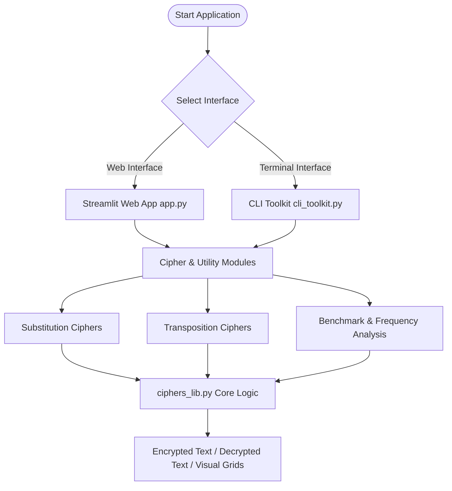

# 🔒 Classical Cryptography Toolkit

[](https://share.streamlit.io/)
[](https://www.python.org/)
[](https://opensource.org/licenses/MIT)

An interactive, high-performance **Classical Cryptography Web Application & CLI Toolkit** built with **Python**, **Streamlit**, **Pandas**, and **NumPy**. This toolkit provides interactive visualization, mathematical breakdown, performance benchmarking, and file encryption/decryption utilities for 8 fundamental classical ciphers.

🔗 **Live Demo:** [Classical Cryptography Toolkit](https://classical-cryptography-toolkit.streamlit.app/)

---

## 🌟 Key Features

### 🔤 1. Substitution Ciphers
- **Caesar Cipher**: Interactive shift slider (1–25) with a full 26-character shift lookup table.
- **Monoalphabetic Cipher**: Custom permutation key mapping with random key generator.
- **Playfair Cipher**: Step-by-step 5×5 matrix visualizer with digraph formatting (combining I/J).
- **Hill Cipher (2×2 Matrix)**: Modular 26 matrix multiplication with automatic inverse matrix verification ($\gcd(\det(K), 26) = 1$).
- **Vigenère Cipher**: Polyalphabetic cipher with key repetition preview table.
- **One-Time Pad (OTP)**: Perfectly secure stream cipher with automatic pseudo-random key generator.

### 🔀 2. Transposition Ciphers
- **Rail Fence Cipher**: Multi-rail depth slider (2–10) with zig-zag wave preview grid.
- **Columnar Transposition Cipher**: Key-ordered grid layout with column sorting breakdown.

### 📊 3. Utilities & Analytical Tools
- **⚡ Live Algorithm Benchmarker**: Side-by-side execution time benchmark (in milliseconds) and key space security analysis with bar chart comparisons.
- **📁 File Encryption & Decryption**: Upload `.txt` files, encrypt or decrypt in real-time, and download results instantly.
- **📈 Frequency Analysis**: Text letter distribution histograms with expected English letter frequency comparison.
- **📚 Concept & Theory Guide**: Comprehensive mathematical manual covering key spaces, equations, and historical significance.

---

## 📐 Mathematical Foundations

| Cipher Algorithm | Encryption Formula | Decryption Formula | Key Space Size |
| :--- | :--- | :--- | :--- |
| **Caesar Cipher** | $C_i = (P_i + k) \pmod{26}$ | $P_i = (C_i - k + 26) \pmod{26}$ | $25$ |
| **Monoalphabetic** | $C_i = \pi(P_i)$ | $P_i = \pi^{-1}(C_i)$ | $26! \approx 4.03 \times 10^{26}$ |
| **Playfair Cipher** | $5 \times 5$ grid digraph transformation | Reverse grid shift / rectangle swap | $25! \approx 1.55 \times 10^{25}$ |
| **Hill Cipher (2x2)** | $C = K \cdot P \pmod{26}$ | $P = K^{-1} \cdot C \pmod{26}$ | $157,248$ (Invertible $2 \times 2$) |
| **Vigenère Cipher** | $C_i = (P_i + K_{i \bmod L}) \pmod{26}$ | $P_i = (C_i - K_{i \bmod L} + 26) \pmod{26}$ | $26^L$ ($L$ = Key length) |
| **One-Time Pad** | $C_i = (P_i + K_i) \pmod{26}$ | $P_i = (C_i - K_i + 26) \pmod{26}$ | $26^N$ (Unbreakable if key is random) |
| **Rail Fence** | Zig-zag diagonal wave routing | Rail depth reconstruction | $R-1$ ($R$ = Rails depth) |
| **Columnar Transposition**| Grid layout sorted by key character order | Column matrix reconstruction | $K!$ ($K$ = Column key length) |

---

## 🛠️ System Architecture



---

## 🚀 Quick Start Guide

### Prerequisites
- Python 3.9 or higher installed.

### 1. Clone the Repository
```bash
git clone https://github.com/Saurabhraut24/Classical-Cryptography-Toolkit.git
cd Classical-Cryptography-Toolkit
```

### 2. Install Dependencies
```bash
pip install -r requirements.txt
```

### 3. Run the Web Application (Streamlit)
```bash
streamlit run app.py
```
The interactive application will launch in your browser at `http://localhost:8501`.

### 4. Run the CLI Terminal Toolkit
```bash
python cli_toolkit.py
```

---

## ☁️ Deployment

This project is configured for **1-click deployment** on **[Streamlit Community Cloud](https://share.streamlit.io/)**:

1. Fork or push this repository to GitHub.
2. Visit [share.streamlit.io](https://share.streamlit.io/).
3. Connect your GitHub account and select repository `Saurabhraut24/Classical-Cryptography-Toolkit`.
4. Set main file path to `app.py` and click **Deploy**.

---

## 📁 Repository Structure

```text
├── app.py              # Streamlit Web Interface (Main Entry Point)
├── ciphers_lib.py      # Core Cryptographic Library & Mathematical Logic
├── cli_toolkit.py      # Menu-Driven Command Line Interface (CLI)
├── technics.py         # Cipher Helper Utilities
├── test_ciphers.py     # Automated Unit Test Suite
├── requirements.txt    # Python Package Dependencies
├── USER_MANUAL.md      # Application Usage Guide
└── PROJECT_REPORT.md   # Project Architecture & Benchmarking Report
```

---

## 📜 License

Distributed under the MIT License. See `LICENSE` for more information.
